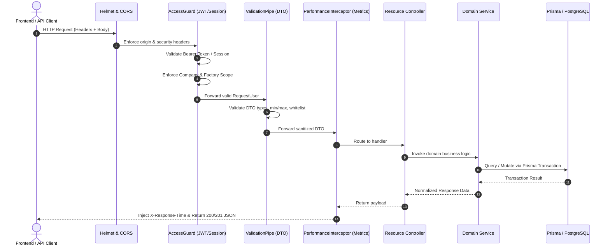

# API Design Architecture Specification (#70)

## 1. Executive Summary & Architectural Overview
The **Rice Mill ERP Platform** exposes a standardized, production-grade **RESTful JSON API** built on NestJS, PostgreSQL, and Prisma ORM. Designed strictly according to the enterprise requirements in `docs/promtdoc.md` (#70), every endpoint adheres to:
1. **Strict REST Resource Modeling**: Canonical URL structure (`/api/v1/:resource`), HTTP method semantics (`GET`, `POST`, `PATCH`, `DELETE`), and standard HTTP response status codes.
2. **Deterministic DTO Validation**: Deep validation on all incoming payload entities using `class-validator` and `class-transformer` via a global `ValidationPipe` configured with `{ whitelist: true, forbidNonWhitelisted: true, transform: true }`.
3. **Multi-Tenant Security & Isolation**: Company- and Factory-scoped authorization enforced through `AccessGuard` and `assertCompanyAccess`, coupled with granular permission-level checking (`@RequirePermission`).
4. **Resilient Query Engine**: Safe pagination capped at 100 records per page (`take: min(limit, 100)`), SQL injection-proof B-Tree indexed sorting (`asc` | `desc`), parameter filtering, and sanitized multi-term search.
5. **Interactive OpenAPI 3.0 Specification**: Automated Swagger documentation generated from NestJS route definitions and DTO decorators available at `/api/docs`.

---

## 2. RESTful Resource Design & URI Scheme
The API is mounted under the global prefix `/api/v1` and partitions resources by domain. Below is the canonical resource map covering all Promptdoc #70 exemplar endpoints:

| Domain | HTTP Method | Endpoint URI | Description | Auth / Permission |
| :--- | :--- | :--- | :--- | :--- |
| **Auth** | `POST` | `/api/v1/auth/login` | Email/password credential authentication | Public |
| **Auth** | `POST` | `/api/v1/auth/otp/request` | One-time sign-in code dispatch | Public |
| **Auth** | `POST` | `/api/v1/auth/otp/verify` | One-time sign-in code verification | Public |
| **Users** | `GET` | `/api/v1/users` | Company user directory and role listing | User Read |
| **Gate** | `POST` | `/api/v1/gate/entries` | Physical vehicle gate entry creation | Gate Create |
| **Weighbridge**| `POST` | `/api/v1/gate/entries/:id/weighbridge` | First (gross) and second (tare) weighing | Weighbridge Create |
| **Quality** | `POST` | `/api/v1/gate/entries/:id/quality-samples`| Laboratory sample collection and test | Quality Create |
| **Procurement**| `POST` | `/api/v1/procurement/purchases` | Agreed paddy purchase order creation | Procurement Create |
| **Inventory** | `POST` | `/api/v1/inventory/transfers` | Warehouse/godown stack transfer | Inventory Update |
| **Production** | `POST` | `/api/v1/production/batches` | Parboiling/milling production batch creation| Production Create |
| **Sales** | `POST` | `/api/v1/sales/orders` | Customer commercial sales order | Sales Create |
| **Invoicing** | `POST` | `/api/v1/sales/orders/:id/invoice` | Sales invoice and accounts receivable post | Sales Create |
| **Dispatch** | `POST` | `/api/v1/dispatch` | Delivery challan and gate pass creation | Dispatch Create |
| **Payments** | `POST` | `/api/v1/accounting/payments` | Supplier, farmer, or customer payment | Accounting Create |
| **Reports** | `GET` | `/api/v1/reports/profit-loss` | Lot/Batch multi-dimensional P&L statement | Reports Read |

---

## 3. Request Lifecycle & Pipeline
Every incoming HTTP request traverses a hardened NestJS execution pipeline before reaching service logic:



---

## 4. DTO Validation & Transformation Standards
All request payloads must be defined as strongly-typed classes adorned with `class-validator` and `class-transformer` decorators. The application pipeline rejects untyped or unwhitelisted properties.

```typescript
export class PaginationQueryDto {
  @IsOptional()
  @Type(() => Number)
  @IsInt()
  @Min(1)
  page?: number = 1;

  @IsOptional()
  @Type(() => Number)
  @IsInt()
  @Min(1)
  @Max(100)
  limit?: number = 25;

  @IsOptional()
  @IsString()
  sortBy?: string = 'createdAt';

  @IsOptional()
  @IsString()
  sortOrder?: 'asc' | 'desc' = 'desc';
}
```

### Validation Invariants:
1. **Zero Raw Any**: Every controller endpoint strictly references a dedicated DTO.
2. **Whitelist Stripping**: Unexpected payload attributes are stripped or rejected (`forbidNonWhitelisted: true`).
3. **Type Coercion**: Query string numbers and booleans are coerced cleanly via `class-transformer`.
4. **Sanitization**: String inputs undergo whitespace trimming and regex validation where required.

---

## 5. Authentication & Token Lifecycle Architecture
Authentication is implemented via stateless signed tokens and cryptographic session records stored in PostgreSQL:
1. **Bearer Authentication**: Clients transmit tokens via `Authorization: Bearer <token>`.
2. **Session Verification**: The token payload specifies `{ id, sessionId, companyIds, memberships }`.
3. **Revocation & Logout**: Deleting or marking the session inactive immediately revokes access without waiting for token expiry.
4. **Device Auditing**: Every session records the client `deviceName`, IP address, and last activity timestamp.

---

## 6. Role-Based Access Control (RBAC) & Factory-Scoping
The ERP implements hierarchical authorization based on:
- **Platform vs. Tenant Scope**: Platform Admins manage system-wide settings, while Mill Admins and Operators are strictly constrained to their tenant `companyId`.
- **Factory Boundary Protection**: A user assigned to `Bogura Factory` cannot read, approve, or post transactions belonging to `Naogaon Factory`.
- **Granular Permissions**: Every route declares its required domain and action:
  ```typescript
  @Post()
  @RequirePermission('gate', PermissionAction.CREATE)
  create(@Body() dto: CreateGateEntryDto, @Req() req: AuthenticatedRequest) {
    return this.gate.createGateEntry(dto, req.user!.id);
  }
  ```

---

## 7. Safe Pagination, Filtering, Sorting & Full-Text Search Specification
To protect against runaway memory usage and unbounded table scans:
1. **Safe Bounds**: Default `limit = 25`, absolute hard cap `limit = 100`.
2. **Database Offsetting**:
   $$\text{skip} = (\text{page} - 1) \times \text{take}$$
3. **Deterministic Sorting**: Whitelisted column names prevent arbitrary SQL sorting. Default ordering is `createdAt DESC`.
4. **Search Term Sanitization**: Search strings are trimmed, normalized, and mapped to ILIKE queries over indexed fields (`name`, `code`, `vehicleNumber`).

---

## 8. OpenAPI 3.0 / Swagger Specification & Interactive Documentation
The NestJS application compiles an OpenAPI 3.0 standard schema exposed at `/api/docs`:
- **Interactive UI**: Swagger UI allows authenticated manual testing of every endpoint.
- **Bearer Auth Header**: Configured with `.addBearerAuth()` so engineers can provide JWT tokens in the browser.
- **Contract Verification**: Unit tests verify document generation directly (`SwaggerModule.createDocument`).

---

## 9. Rate Limiting, CORS, Security Headers & DoS Shield
Production instances are protected against brute-force attacks and abuse:
- **Helmet**: Injects security headers (`X-Content-Type-Options: nosniff`, `X-Frame-Options: SAMEORIGIN`, `Strict-Transport-Security`).
- **CORS Allowlist**: Validates `Origin` against configured company subdomains (`process.env.APP_URL`).
- **File Upload Limits**: Gate photo attachments and document vault uploads are capped at 10 MB and validate MIME type headers.

---

## 10. Audit Logging & Request Metadata Tracing
Every write operation (`POST`, `PATCH`, `DELETE`) automatically persists an audit log entry in PostgreSQL containing:
- `userId`: Identity of the performing user.
- `companyId` & `factoryId`: Tenant partition.
- `action`: Created, Modified, Approved, Voided.
- `entityType` & `entityId`: e.g. `PurchaseOrder`, `GateEntry`.
- `beforeState` & `afterState`: JSON diff of changed attributes.
- `ipAddress` & `userAgent`: Origin metadata.

---

## 11. Backend Unit & Contract Test Suite
The API design compliance is continuously verified by `backend/src/modules/api-design.spec.ts`:
- **Endpoint Structure**: Verifies that standard REST controllers exist for allPromptdoc #70 domains.
- **Global Pipes**: Validates `main.ts` configurations (prefix, helmet, cors, validation pipe).
- **DTO Rules**: Verifies validation error generation for out-of-range pagination, invalid emails, and malformed inputs.
- **OpenAPI Document**: Verifies that `DocumentBuilder` generates compliant OpenAPI 3.0 schemas.

---

## 12. Frontend API Client Integration & Type Safety
The Next.js frontend interacts with the API through the strongly-typed `apiRequest<T>` wrapper:
```typescript
export async function apiRequest<T>(
  path: string,
  options: RequestInit = {},
  authenticate = true
): Promise<T> {
  const url = `${API_BASE_URL}/api/v1${path}`;
  const headers = new Headers(options.headers || {});
  headers.set('Content-Type', 'application/json');
  if (authenticate) {
    const session = readSession();
    if (session?.token) headers.set('Authorization', `Bearer ${session.token}`);
  }
  const response = await fetch(url, { ...options, headers });
  // Unified response parsing & human-readable error unwrapping
  ...
}
```

---

## 13. Promtdoc #70 Compliance Matrix & Verification Checklist

| Requirement | Promtdoc #70 Specification | Implementation Status | Evidence / Verification |
| :--- | :--- | :--- | :--- |
| **REST API Paradigm** | Standard REST routing across all business modules | **COMPLETE** | `/api/v1` prefix, HTTP verbs, canonical resources |
| **POST /auth/login** | Email/Password login endpoint | **COMPLETE** | `src/modules/auth/auth.controller.ts` |
| **POST /auth/otp** | OTP sign-in request and verification | **COMPLETE** | `auth.controller.ts` (`/otp/request`, `/otp/verify`) |
| **GET /users** | User directory and membership listing | **COMPLETE** | `src/modules/users/users.controller.ts` |
| **POST /gate-entries**| Inward and outward gate entry creation | **COMPLETE** | `src/modules/gate/gate.controller.ts` |
| **POST /weighbridge** | Gross and tare weighing tickets | **COMPLETE** | `gate.controller.ts` (`:id/weighbridge`) |
| **POST /quality-tests**| Quality lab sample test records | **COMPLETE** | `gate.controller.ts` (`:id/quality-samples`) |
| **POST /purchases** | Paddy procurement purchase orders | **COMPLETE** | `src/modules/procurement/procurement.controller.ts` |
| **POST /inventory/transfers** | Godown and stack stock movements | **COMPLETE** | `src/modules/inventory/inventory.controller.ts` |
| **POST /production/batches** | Milling batch inputs and outputs | **COMPLETE** | `src/modules/production/production.controller.ts` |
| **POST /sales/orders** | Customer sales orders with stock check | **COMPLETE** | `src/modules/sales/sales.controller.ts` |
| **POST /sales/invoices**| Commercial sales invoices | **COMPLETE** | `sales.controller.ts` (`:id/invoice`) |
| **POST /dispatches** | Delivery challans & gate pass generation | **COMPLETE** | `src/modules/dispatch/dispatch.controller.ts` |
| **POST /payments** | Accounts payable and receivable payments | **COMPLETE** | `src/modules/accounting/accounting.controller.ts` |
| **GET /reports/profit-loss**| P&L and financial statements | **COMPLETE** | `src/modules/reports/reports.controller.ts` |
| **DTO Validation** | Validation pipe with whitelist and transform | **COMPLETE** | `ValidationPipe` in `main.ts`, class-validator DTOs |
| **Authentication** | Bearer JWT / cryptographic session check | **COMPLETE** | `AccessGuard`, `auth.service.ts` |
| **Authorization** | Company & Factory multi-tenant isolation, RBAC | **COMPLETE** | `@RequirePermission`, `assertCompanyAccess` |
| **Pagination** | Safe paging capped at 100 max | **COMPLETE** | `PaginationQueryDto`, `PerformanceService.buildPagination` |
| **Filtering/Sorting/Search** | Indexed query parameters, asc/desc | **COMPLETE** | `PaginationQueryDto`, Prisma index lookups |
| **Swagger Docs** | OpenAPI documentation generation | **COMPLETE** | `DocumentBuilder` in `main.ts`, verified at `/api/docs` |

