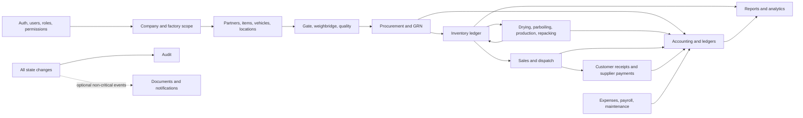
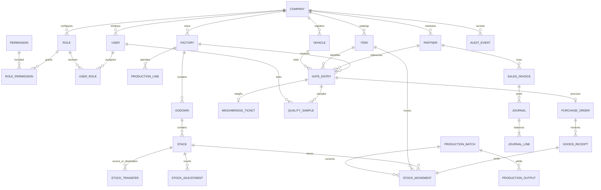

# Rice Mill ERP architecture

## Scope and release boundary

The system is a multi-company, multi-factory ERP. Phase 1 establishes identity, tenant boundaries, factory structure, configurable authorization, and company settings. Procurement through analytics are later modules; the data and event boundaries below keep those modules coherent. Financial and inventory transactions are append-only after posting, and corrections use reversal records.

Industry-reference research is recorded in [research-basis.md](./research-basis.md). Public vendor material is treated as high-level workflow context, not as evidence for undocumented features or as a source to copy. Framework choices and implementation boundaries are recorded in [technology-stack.md](./technology-stack.md).

Every module follows the [module development standard](./module-development-standard.md): design business behavior and its data, calculation, accounting, inventory, API, permission, validation, UI, reporting, and test requirements before implementation. Modules remain partial until their documented workflows are implemented and verified end-to-end.

## Business workflow

Paddy moves through gate entry, gross and tare weighment, quality and moisture assessment, purchase approval, and GRN. GRN posts a lot into a godown stack and records both stock movement and supplier payable/journal. Drying and parboiling record input/output and loss. Milling consumes paddy lots and records rice and by-product outputs with configurable recovery rules. Packaging/repacking converts bulk or packaging stock. Sales reserve stock, invoice, dispatch, collect payment, and post ledger entries. Every stage carries source references, company, factory, location, user, timestamps, and audit events so an owner can trace material and value end-to-end.

## System boundaries

- `frontend`: Next.js App Router, React, TypeScript, MUI, React Hook Form/Zod, TanStack Query. It calls only the REST API and owns no business rules.
- `backend`: NestJS REST API, Prisma, PostgreSQL. Modules own validation, permissions, state transitions, stock posting, accounting posting, and audit events.
- `database`: Prisma schema and migrations; PostgreSQL is the system of record.
- `docs`: architecture and operational runbooks.
- `docker-compose.yml`: local PostgreSQL development service; production container and Nginx deployment composition is reserved for the deployment phase.
- Redis is an optional cache/queue, never the source of truth. File storage uses an adapter so local storage can later be replaced by S3-compatible storage.

## Backend module catalog and ownership

The target backend is a modular NestJS application. Each domain module owns its API, DTOs, service/business rules, permissions, tests, and persistence changes; modules expose services or stable APIs rather than reaching into another module's internal implementation. Cross-cutting database, authentication/authorization, validation, and error handling are shared infrastructure, not duplicated business logic.

The table lists the required logical domains and their present implementation status. “Implemented” means an initial API/workflow exists, not that every master-prompt requirement for that module is complete. Multiple logical domains may share a NestJS module folder in the current vertical slices; the domain boundaries remain explicit.

| Domain group | Required logical modules | Current code organization/status |
|---|---|---|
| Identity and tenant administration | `auth`, `users`, `roles`, `permissions`, `companies`, `factories`, `settings` | NestJS modules exist for auth, users, roles, companies, factories, and settings. Permission catalog/guard is shared with roles and common authorization. Current scope is partial. |
| Audit and shared platform | `audit` | Audit events are written by implemented workflows through shared service logic/schema; a dedicated independently managed audit module and full audit UI/reporting are not complete. |
| Location and warehouse masters | `godowns`, `stacks` | Implemented through the inventory module/controller; standalone domain folders are not required while ownership and API boundaries remain clear. |
| Business partners | `suppliers`, `farmers`, `brokers`, `customers` | Shared `partners` module uses partner types; separate partner-specific ledger/workflows are incomplete. |
| Item and packaging masters | `paddy`, `rice`, `by-products`, `packaging` | Shared `items` module currently models these as item kinds and related attributes; complete packaging stock/cost workflows remain outstanding. |
| Transport, gate, and inspection | `vehicles`, `drivers`, `gate`, `weighbridge`, `quality` | Vehicle/gate/weighbridge/quality APIs are organized in the `gate` module/controller today. Dedicated driver and separately deployable domain modules are not complete. |
| Procurement and material control | `procurement`, `inventory` | Initial paddy purchase, GRN, stock ledger, transfer, adjustment, warehouse, godown, and stack APIs exist. Supplier payable/accounting integration and broader item/lot controls remain incomplete. |
| Factory processing | `drying`, `parboiling`, `production`, `repacking` | Drying, parboiling, and milling-batch/recovery APIs exist. Repacking, costing, machine/line integration, production UI, and financial valuation remain incomplete. |
| Commercial operations | `sales`, `dispatch`, `payments`, `expenses` | Not implemented as complete transaction modules. |
| Finance | `accounting` | Not implemented as a complete double-entry posting, ledger, or financial-report module. |
| People and assets | `hr`, `payroll`, `maintenance` | Not implemented. |
| Documents and communication | `documents`, `notifications` | Not implemented as managed storage, expiry, or delivery workflows. |
| Insight | `reports`, `analytics` | Not implemented as a complete report/analytics module; no fabricated metrics are presented as functional. |

### Dependency and event flow

Core stock and journal effects are synchronous and atomic with their source transaction; asynchronous events may support notifications or derived reports, but cannot be the only record of a stock or financial posting. Reports read authoritative operational records and posted ledgers.

Current code is a modular monolith, not a set of independently deployed microservices. Logical boundaries may be separated into NestJS modules as scope grows, without making a network call between domains in the same process. Current phase details and known omissions are documented in [Phase 3](./phase-3.md), [Phase 4](./phase-4.md), and [Phase 5](./phase-5.md).

Each factory has one primary `productionType` (`AUTO`, `PARBOILED`, `TRADITIONAL`, or `INTEGRATED`) and a set of `businessModes` (`PADDY_TRADING`, `RICE_TRADING`, `WHOLESALE`, `RETAIL`, `DEALER_DISTRIBUTION`, `TOLL_MILLING`). These are factory-level operating configuration, not separate applications. A configured mode describes intended operations; its transaction workflow is only available when the corresponding module is implemented. Multiple factories, godowns, stacks, and production lines remain modeled within the same company and ERP. See [rice mill types and operating modes](./rice-mill-types.md) for the configuration contract and current release boundary.

Factory administration, line setup, access-scoped factory comparison, and their current boundaries are documented in [multi-factory operations](./multi-factory.md).

## Core invariants

1. Every tenant-owned row has `companyId`; factory-scoped rows also have `factoryId`. Queries derive scope from authenticated membership, never a client-supplied company ID alone.
2. A transaction may reference only entities belonging to the same company and, where required, factory. Enforce this in services and with compound unique keys/FKs. Migration `0010_company_scope_integrity` closes remaining cross-company foreign-key gaps in memberships, production lines, packaging suppliers/items, stock items/reversals, and journal reversals. The complete migration chain and six deliberate cross-company mismatch cases were verified against disposable PostgreSQL; all mismatches were rejected by constraints.
3. Quantities use decimal precision, explicit units, and immutable stock-movement rows. Available stock is derived by item/lot/location/stack and reservations.
4. Posting is atomic: validate source state and stock, write source posting state, stock movements, journal header/lines, and audit event in one database transaction.
5. Posted financial/stock documents cannot be edited or deleted. Corrections create linked reversals and replacement documents.
6. Journal debits equal credits per currency; money is stored as `Decimal`, with BDT default. Every posting rule is versioned/configurable.
7. Moisture-adjusted weight and milling recovery are explicit, configurable formulas; retain raw inputs and formula/version used. A calculation result is never the only stored evidence.
8. All timestamps are UTC in the database; UI renders the configured Bangladesh timezone.

## Company and factory isolation

`Company` owns factories and tenant master data. Factory-scoped operational rows carry both `companyId` and `factoryId`; their composite foreign keys bind them to a factory within that same company. Locations and stock stacks are factory-scoped, and stock movements bind their item and optional stack to the same company/factory. Company-scoped records such as partners, items, packaging specs, and unit conversions cannot reference another company's master data. Factory-scoped memberships also bind their factory to their stated company; a company-wide membership has no factory assignment.

Authenticated company/factory scope is resolved in the API guard and services. A client-supplied ID is a selector, not authority. Database constraints provide a second integrity boundary against mismatched references; posted stock is never transferred across companies by a location-to-location transaction.

## Accounting and inventory posting

Purchase approval alone does not move stock. GRN posting debits raw-material inventory (and eligible landed costs), credits supplier control/AP, and creates a positive stock movement against the accepted lot and stack. A purchase return reverses stock and AP using a linked reversal. Production posting consumes input lots and adds output lots; conversion variance/loss goes to configured process loss accounts. Sales invoice posting debits AR and credits sales/revenue and tax accounts; dispatch decrements finished-goods stock. Payment posting debits cash/bank and credits AR/AP as applicable. Expense posting debits expense/asset and credits cash/AP. Each source document has at most one active posting; uniqueness and serializable transaction handling prevent duplicate posts.

## Calculation engine

Store calculation inputs, result, unit, formula key, formula version, and actor on each calculation record. Initial configurable formulas:

- Net received kg = gross kg - tare kg - approved deductions.
- Moisture-adjusted kg = net kg × (100 - actual moisture %) / (100 - standard moisture %), only when enabled by a mill's policy.
- Recovery % = output kg / input kg × 100; yield and loss are separately reported and totals reconciled within configured tolerance.
- Stack available kg = capacity kg - sum(on-hand movements) - active reservations.
- Stock value uses configured weighted average or FIFO policy per company; policy changes apply prospectively.

Validate percentage bounds, nonnegative weights, moisture denominator, unit conversions, capacity, and reconciliation tolerance before posting. Never silently round intermediate values; round at configured posting precision and retain source precision.

## API conventions

REST under `/api/v1`, JSON, DTO validation, JWT access token plus rotated refresh token, Swagger at `/api/docs`. Standard envelope `{success,message,data,meta}` and `{success:false,message,errors}`. Lists accept `page`, `pageSize`, `search`, `sort`, and module filters. Errors use stable codes and human-readable messages. Mutating requests accept idempotency keys. Authenticated requests resolve tenant/factory scope and enforce a permission guard. Writes record request ID and actor in audit data.

Initial routes: `POST /auth/login`, `/auth/refresh`, `/auth/logout`; `GET/POST /companies`; `GET/POST /factories`; `GET/POST /users`; `GET/POST /roles`; `GET/PUT /settings/company`. Phase 1 adds invitation/password setup and role assignment; OTP/email delivery adapters require configured providers and must report unavailable rather than simulate delivery. Phase 3 routes are documented in [phase-3.md](./phase-3.md), Phase 4 routes in [phase-4.md](./phase-4.md), and production, recovery, drying, and parboiling routes in [phase-5.md](./phase-5.md).

## Frontend route structure

`/login`, `/forgot-password`, `/dashboard`, `/setup/company`, `/settings/company`, `/settings/users`, `/settings/roles`, `/settings/factories`. Later routes group by `/procurement`, `/gate`, `/inventory`, `/production`, `/sales`, `/accounting`, `/hr`, `/reports`. Navigation is permission-filtered, but the API remains the authority. Forms share schema-based validation and server errors; lists use server pagination and filters.

Authentication screens and session/login-history behavior are documented in [authentication.md](./authentication.md).

Company identity fields, platform creation, tenant-scoped profile updates, and auditing are documented in [company-master.md](./company-master.md).

## RBAC baseline

Permissions are resource/action pairs. Actions: CREATE, READ, UPDATE, DELETE, APPROVE, REJECT, POST, PRINT, EXPORT, VIEW_FINANCIAL. Role grants are configurable and may be scoped to company or factory. Owner/director can view financial data; operational roles get least-privilege access. SUPER_ADMIN is platform-scoped and does not implicitly transact in a tenant. A user may have multiple role assignments with optional factory scope. Deny by default; permissions are checked on every API request and every sensitive operation.

The seeded default role codes, grant-administration routes, escalation safeguards, and frontend coverage are detailed in [rbac.md](./rbac.md).

## ERD overview

## Development phases

1. Architecture, schema, auth, RBAC, company, factory, users, settings.
2. Supplier/farmer/broker/customer and paddy/rice/by-product/packaging masters.
3. Gate, vehicle, weighbridge, quality.
4. Purchase, GRN, inventory, godown, stack.
5. Drying, parboiling, production, recovery, by-products, repacking.
6. Sales, dispatch, customer payments.
7. Accounting, ledger, P&L, balance sheet.
8. HR, payroll, machine, maintenance.
9. Reports, analytics, notifications, audit.
10. Security/performance hardening, Docker, backups, deployment.

A phase is complete only after its API, permissions, validation, workflow, documentation, and requested tests exist. Phases 1 and 2 establish tenant/auth foundations and master-data APIs; Phase 3 adds gate, weighbridge, and quality; Phase 4 adds the initial purchase/GRN and paddy stock workflows. The frontend currently covers the gate/quality, procurement/GRN, and stock screens; Phase 5 has an initial production-batch and recovery API slice, but drying, parboiling, costing, and a production UI remain outstanding. Sales, accounting, HR/maintenance, management reporting, deployment, backup, and the remaining production workflows are not complete. Production deployment and external provider integrations require their own phase work and environment configuration.
