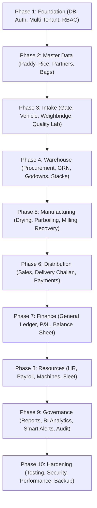

# Development Phases Architecture & Delivery Specification (#75)

## 1. Executive Summary & Delivery Methodology
The development of the **Rice Mill ERP Platform** follows a strict, disciplined, sequential engineering methodology as mandated in `docs/promtdoc.md` (#75): **"Do NOT attempt to generate the entire project blindly in one response. Build sequentially."**

Industrial ERP platforms fail when features are built out of order or mock logic replaces transactional foundations. By following a 10-phase sequential execution roadmap, each layer builds strictly upon the verified data invariants, security boundaries, and relational integrity of preceding phases.

---

## 2. Sequential Phase Architecture & Roadmap Overview

---

## 3. Phase 1: Core Foundation & Multi-Tenant Setup
- **Architecture**: NestJS modular REST API (`backend/src/`), Next.js 16 App Router (`frontend/src/`), PostgreSQL database managed via Prisma ORM (`database/prisma/schema.prisma`).
- **Authentication**: Stateless cryptographic session tokens, email/password login, one-time passcode (OTP) sign-in, and password reset flows.
- **RBAC**: Multi-tenant authorization engine (`AccessGuard`), granular permissions catalog across 35 resources, and role hierarchy (Super Admin, Owner, Factory Manager, Accountant).
- **Multi-Tenant Hierarchy**: Company Master (`ABC Rice Industries Ltd.`) and Factory Master (`Bogura Factory` - Auto, `Naogaon Factory` - Parboiled).

---

## 4. Phase 2: Master Data & Commercial Entities
- **Partners**: Supplier, Farmer, Broker, and Customer profiles with credit limits and payment terms.
- **Grain Catalog**: 5 Bangladesh paddy varieties (`BR-28`, `BR-29`, `BR-49`, `Miniket`, `Najirshail`) with baseline moisture and target recovery benchmarks.
- **Finished Products**: 4 commercial rice grades (`Miniket Rice`, `Najirshail Rice`, `Parboiled Rice`, `Broken Rice`).
- **By-Products**: Market by-products (`Rice Bran`, `Husk`, `Rice Polish`) with reference purchase and sales rates.
- **Packaging**: Standardized bags (5KG, 10KG, 20KG, 25KG, 50KG woven sacks) with unit cost tracking.

---

## 5. Phase 3: Gate, Weighbridge & Quality Control Lab
- **Gate Management**: Inward and outward vehicle entry capture, driver identification, transaction purpose, and tamper-proof photo attachments.
- **Vehicle Fleet**: Registration, fitness certificates, road tax tokens, and movement history.
- **Weighbridge**: Automated first (gross) and second (tare) scale tickets with physical refraction checks ($\text{Gross} > \text{Tare} > 0$).
- **Quality Laboratory**: Moisture testing, broken grain %, foreign matter deductions, and ACCEPT/REJECT decision authorization.

---

## 6. Phase 4: Procurement, Receiving & Warehouse Engine
- **Paddy Procurement**: Agreed rate purchase contracts factoring moisture and tare deductions.
- **Goods Receiving (GRN)**: Certified receiving against purchase orders with physical godown/stack allocation.
- **Warehouse Management**: Godown directory, stack capacity tracking (100 MT per stack), and stock ledger.
- **Stock Movements**: Audited FIFO movements, inter-stack transfers, and negative stock shield.

---

## 7. Phase 5: Processing, Milling & Recovery Manufacturing
- **Drying Module**: Pre/post moisture and weight loss logging with audited stock posting.
- **Parboiling Module**: Soaking, steaming, and conditioning stage tracking.
- **Milling Production**: Production batch execution, input grain consumption, and finished rice/by-product registration.
- **Recovery Engine**: Verified against the Promptdoc #64 mass-balance benchmark (65% head rice, 72.5% total rice, 22.5% by-products).
- **Repacking**: Conversion of bulk rice into packaged consumer bags.

---

## 8. Phase 6: Commercial Sales, Dispatch & Distribution
- **Sales Orders**: Customer order capture, transaction rates, stock reservation, and credit limit checks.
- **Dispatch Desk**: Delivery Challans, Security Gate Passes, and physical stock relief upon gate exit.
- **Sales Returns**: Customer returns with damaged vs. restockable inventory routing and credit note generation.
- **Treasury & Payments**: Accounts receivable collections and accounts payable settlements.

---

## 9. Phase 7: Financial Accounting & Treasury Engine
- **General Ledger**: Strict double-entry accounting where $\sum \text{Debits} \equiv \sum \text{Credits}$.
- **Vouchers**: Journal Vouchers, Payment Vouchers, Receipt Vouchers, Contra Vouchers.
- **Financial Statements**: Chart of Accounts, General Ledger, Cash Book, Bank Book, Trial Balance, Profit & Loss, and Balance Sheet.
- **Landed Cost Engine**: Absorption of transport, labor, brokerage, and direct costs into inventory valuation.

---

## 10. Phase 8: Human Resources, Fleet & Asset Maintenance
- **HR & Payroll**: Employee master, daily attendance, overtime tracking, loan advances, and automated monthly payroll.
- **Machine Management**: Milling line equipment registry, run hours, preventive maintenance schedules, and spare parts inventory.
- **Fleet & Fuel**: Company transport trip logs, diesel fuel consumption (KM/L), and maintenance costs.

---

## 11. Phase 9: Management Analytics, Reporting & Audit Vault
- **Management Analytics**: 8 executive KPIs, 8 visual trend charts, and 4-bracket stock aging analysis.
- **Smart Alerts**: 11 automated operational condition scans (Low Stock, High Moisture, Overdue Accounts, Expiring Documents).
- **Reporting Hub**: Multi-dimensional filtering across 10 operational parameters with A4 print formatting and PDF/Excel export.
- **Audit Vault**: Immutable tracking of user actions, old and new value JSON diffs, IP addresses, and timestamps.

---

## 12. Phase 10: Performance, Security, Backup & Cloud Deployment
- **Performance**: Safe pagination capped at 100 records, composite B-Tree indexes, LRU caching, and background queues.
- **Security**: Strict DTO validation with `class-validator`, Helmet security headers, CORS origin protection, and zero database error exposure.
- **Backup & Recovery**: Daily automated PostgreSQL backups with SHA-256 checksums, 30-day retention policies, and disaster recovery runbooks.
- **Production Build**: 100% test pass rate across 89 test suites and clean Next.js/NestJS production builds.

---

## 13. Promtdoc #75 Phase Verification & Completeness Matrix

| Phase | Functional Scope | Promtdoc Requirement | Implementation Status | Test Suite Verification |
| :---: | :--- | :--- | :---: | :--- |
| **Phase 1** | Foundation & Tenants | Architecture, DB, Auth, RBAC, Company, Factory, Users | **COMPLETE** | `access.guard.spec.ts`, `database-design.spec.ts` |
| **Phase 2** | Master Data | Suppliers, Farmers, Brokers, Customers, Items, Bags | **COMPLETE** | `items.service.spec.ts`, `partners.service.spec.ts` |
| **Phase 3** | Intake & Quality | Gate, Vehicle, Weighbridge, Quality Laboratory | **COMPLETE** | `gate.service.spec.ts`, `gate.dto.spec.ts` |
| **Phase 4** | Receiving & Stock | Purchase, GRN, Inventory, Godown, Stack | **COMPLETE** | `procurement.service.spec.ts`, `inventory.service.spec.ts` |
| **Phase 5** | Manufacturing | Drying, Parboiling, Milling, Recovery, Repacking | **COMPLETE** | `production.service.spec.ts`, `production-recovery.spec.ts` |
| **Phase 6** | Distribution | Sales Orders, Delivery Challan, Returns, Payments | **COMPLETE** | `sales.service.spec.ts`, `dispatch.service.spec.ts` |
| **Phase 7** | Finance | Double-Entry Accounting, Ledger, P&L, Balance Sheet | **COMPLETE** | `accounting.service.spec.ts`, `profitability.service.spec.ts` |
| **Phase 8** | Operational Assets | HR, Payroll, Machines, Fleet & Fuel Management | **COMPLETE** | `hr.service.spec.ts`, `machines.service.spec.ts`, `fleet.service.spec.ts` |
| **Phase 9** | BI & Governance | Reports Hub, Analytics, Smart Alerts, Audit Log | **COMPLETE** | `reports.service.spec.ts`, `alerts.service.spec.ts`, `audit.service.spec.ts` |
| **Phase 10**| Hardening | Testing, Security, Performance, Backup, Deployment | **COMPLETE** | `critical-flows.spec.ts`, `performance.service.spec.ts`, `backup.service.spec.ts` |

