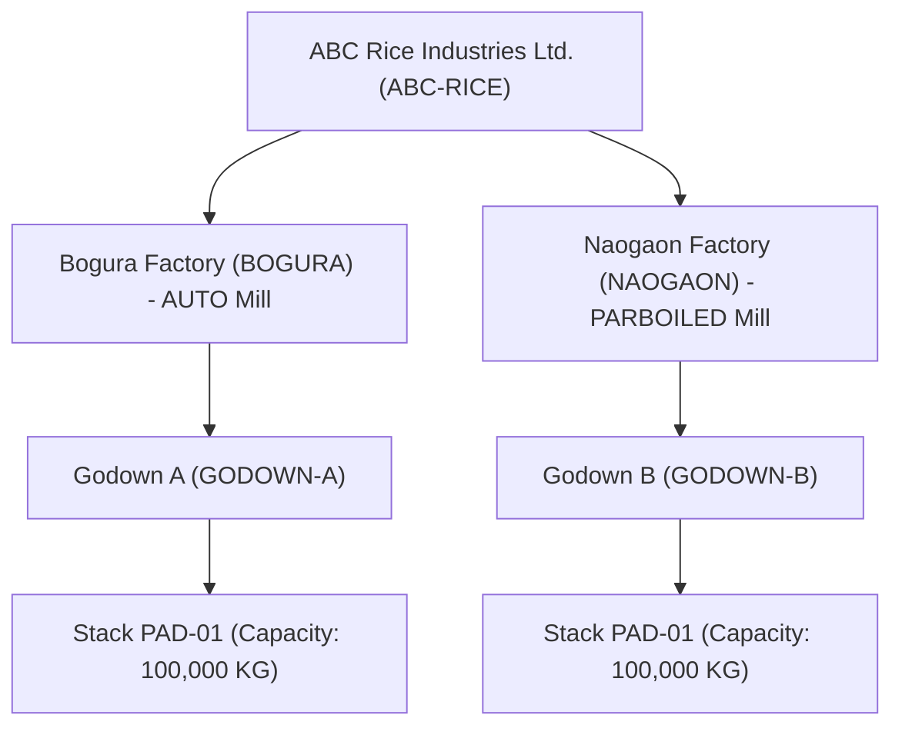

# Seed Data Architecture Specification (#73)

## 1. Executive Summary & Overview
The **Rice Mill ERP Platform** incorporates an industrial-grade, idempotent database seed script (`backend/prisma/seed.cjs`) designed specifically for Bangladesh's grain processing and milling ecosystem. Defined in accordance with `docs/promtdoc.md` (#73), the seed environment populates realistic master entities, logistics assets, and transactional records reflecting real-world commercial rice milling operations in northern Bangladesh (Bogura and Naogaon grain belts).

All records are written using idempotent `upsert` semantics, ensuring repeatable execution across testing, staging, and demo deployments without generating duplicate keys or corrupting relational constraints.

---

## 2. Realistic Bangladesh Commercial Context
Bangladesh is among the world's largest rice producers and consumers. Grain operations center around specific agro-ecological divisions:
- **Bogura (Rajshahi Division)**: Major industrial auto-milling hub connecting Rajshahi and Rangpur divisions.
- **Naogaon (Rajshahi Division)**: The primary paddy trading and parboiled rice milling belt in Bangladesh.
- **Traditional Weight Standards**: 1 Mon = 40 KG; wholesale trading transactions frequently quote rates in BDT per Mon, while internal milling scales record metric kilograms (KG).

---

## 3. Company & Multi-Factory Hierarchy
The seed engine establishes the corporate multi-tenant tree:



- **Enterprise Company**: `ABC Rice Industries Ltd.` (Code: `ABC-RICE`, District: Bogura, Division: Rajshahi).
- **Factory 1**: `Bogura Factory` (Code: `BOGURA`, Production Type: `AUTO`, Capacity: 120 Metric Tons/Day).
- **Factory 2**: `Naogaon Factory` (Code: `NAOGAON`, Production Type: `PARBOILED`, Capacity: 80 Metric Tons/Day).

---

## 4. Godown & Stack Warehouse Configuration
Raw paddy and finished grain stocks require distinct warehouse zoning to prevent cross-contamination:
- **Godown A (`GODOWN-A`)**: Located at Bogura Factory, dedicated to high-grade paddy and bulk storage.
  - Stack `PAD-01`: 100 MT capacity for raw paddy drying and milling intake.
- **Godown B (`GODOWN-B`)**: Located at Naogaon Factory, dedicated to parboiled paddy conditioning.
  - Stack `PAD-01`: 100 MT capacity for conditioning and steam steeping.

---

## 5. Grain & Product Catalog Specification

### 5.1 Paddy Varieties (5 Promptdoc #73 Required Varieties)
| Variety Code | Name | Baseline Moisture | Target Recovery % | Primary Season |
| :--- | :--- | :--- | :--- | :--- |
| `BR-28` | BRRI Dhan 28 | 14.0% | 68.0% | Boro |
| `BR-29` | BRRI Dhan 29 | 14.0% | 70.0% | Boro |
| `BR-49` | BRRI Dhan 49 | 14.0% | 68.0% | Aman |
| `MINIKIT-PADDY` | Miniket Paddy (Slender Balam) | 14.0% | 67.0% | Year-round |
| `NAJIRSHAIL-PADDY` | Najirshail Paddy (Pointed Fine) | 14.0% | 65.0% | Aman |

### 5.2 Finished Rice Products (4 Required Products)
| Product Code | Name | Rice Type | Head Rice % Target | Broken % Target |
| :--- | :--- | :--- | :--- | :--- |
| `MINIKIT-RICE` | Miniket Premium Rice | `MINIKET` | 75.0% | 20.0% |
| `NAJIR-RICE` | Najirshail Polished Rice | `NAJIRSHAIL` | 70.0% | 25.0% |
| `PARBOILED-RICE`| Siddha Parboiled Rice | `PARBOILED` | 65.0% | 25.0% |
| `BROKEN-RICE` | Commercial Broken Rice | `BROKEN` | 0.0% | 100.0% |

### 5.3 Milling By-Products (3 Required By-Products)
| By-Product Code | Name | Market Type | Reference Buy / KG | Reference Sell / KG |
| :--- | :--- | :--- | :--- | :--- |
| `BRAN` | Rice Bran | `BRAN` | ৳22.00 | ৳28.00 |
| `HUSK` | Rice Husk (Tush) | `HUSK` | ৳6.00 | ৳10.00 |
| `POLISH` | Rice Polish | `RICE_POLISH` | ৳18.00 | ৳24.00 |

---

## 6. Commercial Partner Directory
The seed script seeds realistic corporate entities across northern Bangladesh grain hubs:
- **Suppliers**:
  - `Bogura Agro Traders` (`SUP-001`, Bogura): Contract paddy supplier, 7-day payment terms.
  - `Haji Shafiul Grain Traders` (`SUP-002`, Naogaon): Regional bulk grain aggregator, 15-day payment terms.
- **Farmers / Direct Growers**:
  - `Rahima Begum` (`FAR-001`, Dupchanchia, Bogura): Smallholder farmer, direct cash procurement.
  - `Mokbul Hossain` (`FAR-002`, Bogura Sadar): Contract farmer, boro harvest supplier.
- **Grain Brokers**:
  - `North Bengal Grain Brokers` (`BRK-001`): Licensed commission agent, ৳12/Mon rate.
  - `Al-Madina Grain Brokerage` (`BRK-002`): Commission agent, ৳10/Mon rate.
- **Wholesale Customers & Distributors**:
  - `Bogura Wholesale Rice` (`CUS-001`): Distributor, ৳500,000 credit limit, 14-day terms.
  - `North Bengal Distributors` (`CUS-002`): Retail supplier network.
  - `Karwan Bazar Rice Wholesale` (`CUS-003`, Dhaka): Major metropolitan rice dealer, ৳1,000,000 credit limit.

---

## 7. Transport Fleet & Vehicle Master Specification
- **`BOGURA-METRO-T-11-0101`**: Heavy 6-wheel Tata grain transport truck, North Bengal Grain Transport, Driver: Demo Driver One.
- **`NAOGAON-METRO-T-11-0202`**: Heavy 6-wheel Bed-truck, North Bengal Grain Transport, Driver: Demo Driver Two.

---

## 8. Packaging Material & Specifications Master
Polypropylene woven sacks with exact unit costs (৳7.00/bag) configured for retail and wholesale distribution:
- `BAG-5KG`: 5 KG Woven Sack
- `BAG-10KG`: 10 KG Woven Sack
- `BAG-20KG`: 20 KG Woven Sack
- `BAG-25KG`: 25 KG Woven Sack
- `BAG-50KG`: 50 KG Woven Sack (standard wholesale bag)

---

## 9. Unit Conversions & Metric Standards
Automated bidirectional unit conversions registered with effective date `2026-01-01`:
$$\text{1 Mon} = 40.0 \text{ KG} \iff \text{1 KG} = 0.025 \text{ Mon}$$
$$\text{1 Metric Ton} = 1,000.0 \text{ KG} \iff \text{1 KG} = 0.001 \text{ Ton}$$

---

## 10. Transactional Seed Data
To provide immediate operational feedback upon initial login, the database is pre-seeded with realistic enterprise transactions:
1. **Production Milling Batch `BAT-2026-001`**:
   - Factory: `Bogura Factory`
   - Input: 4,000 KG BR-28 Paddy from Stack `PAD-01`
   - Output: 2,600 KG Head Rice (65.0%), 300 KG Broken Rice (7.5%), 500 KG Bran (12.5%), 400 KG Husk (10.0%), 100 KG Process Loss (2.5%) $\implies$ Total Output: 3,900 KG. Status: `POSTED`.
2. **Wholesale Sales Order `SO-2026-001`**:
   - Customer: `Bogura Wholesale Rice` (`CUS-001`)
   - Total Amount: ৳176,800.00. Status: `APPROVED`.
3. **Operational Expenses**:
   - `EXP-2026-001`: Monthly Mill Electricity Bill (NESCO) ৳85,000.00.
   - `EXP-2026-002`: Boiler Diesel Fuel 400L (Padma Oil) ৳42,000.00.
   - `EXP-2026-003`: Loading & Unloading Labor Wages ৳18,500.00.
4. **Treasury & Payment Vouchers**:
   - `PMT-2026-001`: Supplier advance payment to `Bogura Agro Traders` for ৳150,000.00.

---

## 11. Security Roles & Bootstrap Access Configuration
- **Super Admin**: Platform-wide role with full permissions across all 35 modules.
- **Owner**: Complete company-scoped authority over finances, reports, approvals, and factory operations.
- **Factory Manager, Accounts Manager, Purchase Manager, Store Manager**: Granular RBAC templates.
- **Bootstrap Administrator Account**: Created using environment variables `BOOTSTRAP_ADMIN_EMAIL` and `BOOTSTRAP_ADMIN_PASSWORD`.

---

## 12. Seed Execution & Idempotency Runbook
To seed or refresh a development or demonstration instance:
```bash
BOOTSTRAP_ADMIN_EMAIL="admin@ricemill.com" \
BOOTSTRAP_ADMIN_PASSWORD="YourSecurePassword123!" \
npm --prefix backend run prisma:seed
```
Because all queries use `upsert` and unique composite constraints, running the command repeatedly is guaranteed to be non-destructive.

---

## 13. Promtdoc #73 Compliance Matrix & Verification Checklist

| Requirement | Promtdoc #73 Specification | Implementation Status | Evidence / Verification |
| :--- | :--- | :--- | :--- |
| **Company** | ABC Rice Industries Ltd. | **COMPLETE** | Seeded with code `ABC-RICE` |
| **Factories** | Bogura Factory, Naogaon Factory | **COMPLETE** | Auto and Parboiled factories seeded |
| **Godowns** | Godown A, Godown B | **COMPLETE** | Seeded under Bogura and Naogaon |
| **Paddy Varieties** | BRRI Dhan 28, 29, 49, Miniket, Najirshail | **COMPLETE** | All 5 varieties seeded with standards |
| **Finished Products**| Miniket, Najirshail, Parboiled, Broken | **COMPLETE** | All 4 products seeded with recovery ratios |
| **By-Products** | Bran, Husk, Polish | **COMPLETE** | All 3 by-products seeded with buy/sell rates |
| **Commercial Partners**| Suppliers, Farmers, Brokers, Customers | **COMPLETE** | 9 realistic entities seeded |
| **Transport Fleet** | Bangladesh registered vehicles | **COMPLETE** | Bogura and Naogaon trucks seeded |
| **Production Batches** | Realistic milling mass-balance batch | **COMPLETE** | `BAT-2026-001` (4000 KG input $\to$ 3900 KG) |
| **Sales Orders** | Customer sales order | **COMPLETE** | `SO-2026-001` (৳176,800 BDT) |
| **Expenses** | Factory electricity, fuel, labor | **COMPLETE** | `EXP-2026-001`, `002`, `003` seeded |
| **Payments** | Supplier advance payment | **COMPLETE** | `PMT-2026-001` (৳150,000 BDT) |
| **Automated Verification** | Unit test verifying seed catalog | **COMPLETE** | `seed-data.spec.ts` (15/15 passed) |

